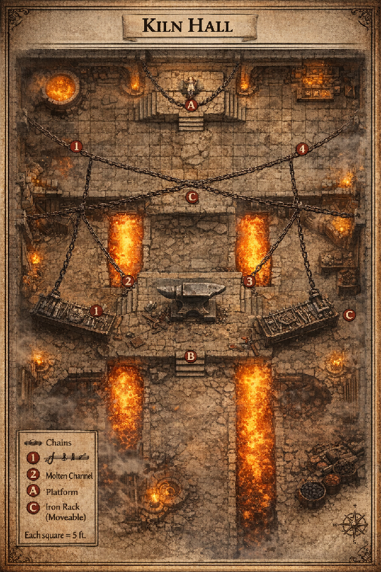
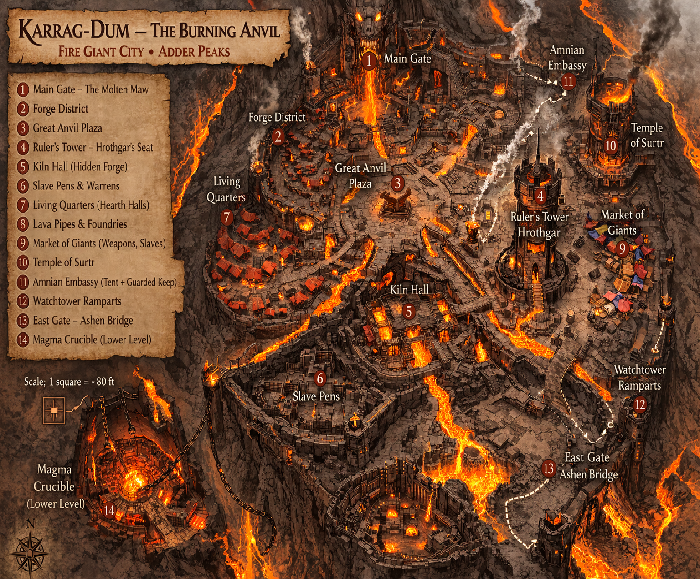

Oh this is going to feel epic. You’ve got politics, giants, Amnian interference, wild fey forests, and a 7-player party at level 2 — that’s ambitious in the best way.

We’ll structure this as:

**Session 1 (5 hrs):**

* Departure from **Ormpetarr**

* Political complications

* Through **Chondalwood**

* Satyr entanglement

* Revelation about Amn

**Session 2 (5 hrs):**

* Into the foothills

* Adder Peaks hazards

* Fire giant forward camp

* Modified Kiln Hall (level 2 viable)

---

**🌆 SESSION 1 – The Forest That Laughs**

## **Act I – Departure from Ormpetarr (45–60 min)**

Princess Carlalyn Hawklin’s capture has shaken the city. Rumors say the fire giants were “funded.”

Whispers point toward:  
 **Amn**

### **Encounter 1: The Amnian Delay**

As the party prepares to leave, Amnian agents try to stall them.

**Encounter:**

* 1 Spy

* 3 Thugs

Goal isn’t death — it’s delay and intimidation.

Clue found:

* Payment ledger referencing “Forge Agreement – Adder Contract.”

This establishes:  
 Amn didn’t just hire giants — they made a deal.

---

## **Act II – Entering the Chondalwood (1.5–2 hrs)**

The forest shifts tone immediately.

### **Travel Features:**

* Animal calls that sound like laughter.

* Paths rearrange.

* Fey wine scent in the air.

---

## **Encounter 2: Satyr Revel (Social or Combat)**

A troop of 5 Satyrs blocks the path.

They are not evil — just chaotic and territorial.

They demand:

* A story

* A performance

* A secret

* Or wine

If combat occurs:  
 Reduce their HP slightly (they’re rowdy, not lethal).

The tiefling monk and half-elf cleric of Loki can shine here.

Satyrs reveal:

> “The red ones march to the smoking teeth. They carry something bright and screaming.”

They saw Carlalyn alive.

---

## **Encounter 3: Fey Trick Trap (Skill Challenge)**

Forest illusion — the party sees Carlalyn running through trees.

It’s a glamour.

Skill challenge:

* Insight (DC 12\)

* Survival (DC 12\)

* Religion (DC 13 if invoking Loki or druidic lore)

Failure:  
 They wander into a bramble trap (restrained vines, 1d6 damage).

Success:  
 They gain advantage on next forest navigation roll.

---

## **Encounter 4: Amnian Shadow Patrol (Hard Combat)**

In a forest clearing, mercenary outriders with a mage.

* 1 Apprentice Wizard

* 3 Bandits

* 1 Scout

They are observing giant movements.

Letter found:

> “Kiln Hall must remain intact. Payment upon containment of Hawklin asset.”

Important: “Containment,” not execution.

Session 1 ends with:  
 Smoke visible in the distant peaks.

---

**⛰ SESSION 2 – The Adder Peaks**

Location: **Adder Peaks**

Tone shifts to harsh stone, ash winds.

---

## **Encounter 5: Rockslide Hazard (Skill Scene)**

Triggered by distant giant hammer strikes.

Group skill challenge:

* Athletics (brace others)

* Acrobatics (dodge falling stone)

* Perception (spot safe ledges)

Failure \= party split temporarily (short tension moment).

---

## **Encounter 6: Fire Giant Foraging Squad (Scary But Fair)**

Level 2 party cannot handle a full fire giant.

So we use:

* 1 Fire Giant Smith (heavily wounded, 50% HP)

* 2 Magma Mephits

The giant is NOT interested in a prolonged fight.  
 He withdraws if reduced below half.

The dragonborn fighter shines here.

Clue:  
 They are preparing something larger in the Kiln Hall.

---

**Karrag-Dum — The Burning Anvil \- Karrag-Dum in Giant “City of the Burning Hammer.”**

Why it works:

* Feels ancient

* Sounds massive

* Easy for players to remember

* Perfect location for **Kiln Hall**

You can describe it as:

> The mountain opens like a wound. Inside, tiered iron streets glow red from rivers of magma. Towers of black basalt rise like anvils. The thunder of hammers echoes across the valley as the fire giant city of **Karrag-Dum** burns against the night.

**🔥 Ruler of Karrag-Dum**

**Thane Hrothgar Embercrown**

**Type: Fire Giant Warlord**  **Location: Royal Hall in Karrag-Dum**

### **Description**

**Hrothgar is enormous even for a fire giant. His crown is a ring of black iron embedded with burning coals. His armor is etched with ancient runes honoring Surtr.**

**He is not cruel—he is proud and pragmatic.**

### **Motivation**

**He believes the deal with Amn will give the giants permanent dominion over the Adder Peaks.**

**Princess Carlalyn is:**

> # **“A bargaining token in a treaty of stone and fire.”**

**If the party encounters him, he may talk before attacking, especially if the cleric or druid tries diplomacy.**

---

**🕶️ Crossing the City: 5 Stealth Encounters**

**These are designed to create tension without overwhelming a level-2 party.**

---

**1\. The Slave Caravan**

**Location: Near the Slaves’ Yard**

**A column of chained prisoners (humans, dwarves, halflings) is being marched to the Foundry.**

**Guards:**

* # **1 Azer** 

* # **2 Hobgoblin overseers** 

### **Options**

**• Hide among crates**  **• Free a prisoner quietly**  **• Cause a distraction (fire, falling stone)**

**If the party helps the prisoners, they learn:**

> # **“The princess is in the *deep forge* — the place the giants call Kiln Hall.”**

---

**2\. The Lava Bridge Patrol**

**Location: Narrow bridge over molten rock.**

**Patrol:**

* # **2 Magma Mephits** 

* # **1 Hell Hound** 

**The hell hound can smell intruders, creating a tense stealth check.**

**Creative ideas players might try:**

* # **Throw meat** 

* # **Illusion magic** 

* # **The monk or rogue silently dropping the mephits** 

---

**3\. The Great Anvil Plaza**

**This is the center of the city.**

**A colossal anvil the size of a cottage stands here while two fire giants hammer a massive sword.**

**Stealth Challenge:**  **The hammer strikes mask sound every few seconds.**

**Players must move between hammer blows.**

**Success: cross unseen**  **Failure: a giant briefly scans the plaza**

**This moment makes the city feel enormous.**

---

**4\. The Amnian Envoys**

**Location: Outside the Amnian Embassy**

**Representatives from Amn are negotiating with giants.**

**NPCs:**

* # **1 Amnian Mage** 

* # **2 Veteran Mercenaries** 

**They discuss:**

> # **“Once the Hawklin girl is secured, the giants will enforce our mining rights.”**

**This confirms the political conspiracy.**

**The rogue will love spying here.**

---

**5\. The Training Grounds**

**Young fire giants hurl boulders at iron targets.**

**Obstacle:**  **The party must cross open ground.**

**Ideas players may attempt:**

* # **Wait for thrown boulders to cause dust clouds** 

* # **Hide inside giant armor racks** 

* # **Create diversion explosions** 

**A goliath barbarian might even blend in from afar for a moment.**

---

**🎭 Dramatic Discovery Scene**

**This moment should occur just before Kiln Hall.**

**Location: A lava-lit forge corridor.**

**The party sneaks past a massive forge chamber where giants are discussing the princess.**

**One giant says:**

> # **“The little one screams every time the brand is heated.”**

**Another replies:**

> # **“Good. Let the Amnians see her spirit break.”**

**Suddenly—**

**One giant turns.**

**He smells something.**

**The hellish glow of the forge illuminates the party.**

**The giant bellows:**

> # **“THIEVES IN THE FORGE\!”**

**A massive iron horn sounds across Karrag-Dum.**

**Footsteps echo.**

**The city begins to wake.**

**This forces the party to rush into Kiln Hall, triggering the final encounter.**

---

**🎬 Cinematic Moment for the Rescue**

**When the party frees the princess:**

**She sees them and says:**

> # **“You crossed the Burning Anvil for me?”**

**Then alarms echo through the city.**

**Outside the forge doors:**

**The silhouette of Thane Hrothgar Embercrown appears in the molten light.**

**He raises his hammer and says:**

> # **“So… the little sparks have come for their flame.”**

**End scene.**

**🔥 Modified Kiln Hall – Level 2 Version**

Original likely too deadly. Here’s a workable version.

## **Layout**

* Large forge chamber

* Molten channel crossing the floor

* Overhead chains

* Giant anvil platform

Princess Carlalyn is restrained on elevated platform.

---

## **Enemies (Scaled)**

Instead of full fire giant leadership:

* 1 Fire Giant Smith (reduced stats: HP 70, no multiattack)

* 2 Azer Forgelings (use Azer stat block but reduce HP to 20\)

* 2 Magma Mephits

The Smith is overseeing ritual forging of a “Binding Brand.”

---

## **Environmental Mechanics (This Makes It Winnable)**

Molten Channel:

* DC 12 Dex to leap

* Falling in \= 2d6 fire \+ ongoing 1d4

Chains Overhead:

* Can be cut to drop heavy iron racks (2d6 bludgeoning to area)

Anvil Platform:

* Can be shoved (group Athletics DC 15\) to destabilize Smith

Princess:  
 Bound but conscious.  
 Can shout warnings about molten surges.

---

## **Tactical Balancing for 7 PCs**

* Mephits explode when killed (remind them)

* Smith focuses on one visible threat at a time

* If party uses terrain cleverly, they win decisively

If fight turns deadly:  
 Satyrs from Session 1 arrive, hurling fey wine bombs.

---

**Political Twist Ending**

Upon rescue:

Princess Carlalyn reveals:  
 Amn offered giants land rights in the Adder Peaks.

This isn’t a kidnapping.  
 It’s leverage in a trade war.

The party now holds proof that:  
 **Amn**  
 is destabilizing Chondath.

Ormpetarr’s rulers will want this handled quietly.

---

**Spotlight Moments by Character**

Cleric of Loki → Fey negotiations  
 Druid → Forest navigation \+ elemental control  
 Aasimar Rogue → Sabotage chains  
 Dragonborn Fighter → Giant duel  
 Elf Ranger → Tracking through Chondalwood  
 Tiefling Monk → Satyr interaction \+ mobility in forge  
 Goliath Barbarian → Physical dominance in Kiln Hall

---

If you’d like next, I can:

* Create a battle map for the Kiln Hall

* Write a cinematic fire giant speech

* Create stat tweaks formatted cleanly for print

* Add a secret third faction manipulating Amn

How hard do you want the final fight to feel — desperate survival or heroic dominance?

> 

What do we think Amn intentions are with the Fire Giants? Do we think they are sincere in offering to recognize the kingdom if the giants help them foil the marriage of the princesses? As merchants this would make sense but could Amn have other/darker intentions? Thoughts?

Short answer: **Amn is almost certainly not being fully sincere.**  
 But the *best version* of this plot is that their intentions are **layered**—plausibly legitimate on the surface, ruthlessly opportunistic underneath, and potentially very dark at the core.

Let’s break it down in a way you can use at the table.

---

**🪙 What Amn *Says* It Wants**

From the perspective of **Amn**, the deal is simple:

* Disrupt the royal marriage (which likely creates a rival power bloc)  
* Use fire giants to destabilize the region  
* In exchange: recognize a giant-held territory in the **Adder Peaks**

This is actually *very on brand* for Amn:

* Outsource violence  
* Avoid direct military risk  
* Profit from instability

So yes—**on the surface, this is credible.**

---

**⚖️ Layer 1: The “Sincere” Version (What the Giants Believe)**

Queen Hrothgarda likely believes:

> “We take the mountains. Amn recognizes our sovereignty. Trade follows.”

And to be fair, Amn *might* intend to honor this—**temporarily**.

Why?

* A stable giant kingdom could secure trade routes  
* Giants could act as **enforcers** for caravans  
* Amn gains indirect control without occupation

This is the *cleanest* interpretation—and a great red herring.

---

**🗡️ Layer 2: The Merchant Reality (Most Likely)**

Amn doesn’t want a **giant kingdom**.

It wants a **controlled resource zone**.

Fire giants bring:

* Unmatched forging capability  
* Access to deep mineral veins  
* Ability to reshape terrain

So the real plan is likely:

> Use the giants to secure and industrialize the region…  
>  then bind them economically.

How?

* Exclusive trade agreements  
* Control of supply lines (food, materials)  
* Debt-based leverage

Eventually:  
 The giants aren’t rulers.

They’re **contracted labor with crowns.**

---

**🌑 Layer 3: The Darker Possibility (Highly Fun for Story)**

This is where things get *really interesting*.

Amn may not just be using the giants…

They may be planning to **break them.**

### **Option A: Resource Extraction at Any Cost**

The Adder Peaks may contain something rare:

* Primordial fire veins  
* Netherese relics  
* Elemental binding sites

The giants are simply the **tools** to dig it out.

Once done?

They become expendable.

---

### **Option B: The Binding Strategy**

The “recognition” of a giant kingdom comes with:

* Magical treaties  
* Binding oaths  
* Enchanted contracts

Very Amnian.

Imagine:  
 The agreement itself is a **trap**.

Once signed, the giants are magically compelled to serve.

---

### **Option C: Internal Sabotage**

Amn may be quietly ensuring:

* Rival giant factions rise  
* Queen Hrothgarda’s rule becomes unstable  
* Civil conflict weakens the city

Divide → weaken → control

---

**🔥 My Recommended Direction (Best Drama)**

Combine Layers 2 \+ 3:

Amn **intends to honor the deal just long enough** to:

1. Let the giants secure the Adder Peaks  
2. Use them to eliminate regional threats (like the princess alliance)  
3. Lock them into contracts  
4. Slowly strip their independence

And possibly…

5. Replace them once their usefulness ends

---

**🎭 How This Plays at the Table**

This gives you AMAZING roleplay options.

### **If the party tells Queen Hrothgarda:**

She might respond:

> “Humans always speak of betrayal…  
>  but it is *you* who come with blades in the dark.”

She doesn’t *yet* see the trap.

---

### **If they bring proof (documents, overheard plans):**

Now you get tension:

> “You would have me believe I am being forged… into a tool?”

That’s a turning point.

---

**💥 Big Choice for the Party**

This setup creates a powerful decision:

Do they:

* Just rescue the princess and flee?  
* Expose Amn and risk a giant alliance?  
* Turn Queen Hrothgarda into an ally?  
* Or let giants and Amn weaken each other?

---

**🧠 Final Thought**

Amn doesn’t think in terms of good or evil.

They think in terms of:

> **“What is the return on this investment?”**

And right now, fire giants are a **very profitable asset.**

---

If you want, I can next:

* Create **a secret Amnian contract document** the party can find  
* Design **a rival giant faction that distrusts the deal**  
* Or build a **negotiation scene with Queen Hrothgarda** where the party can shift the entire campaign direction

This is shaping into a *seriously* rich political arc.

